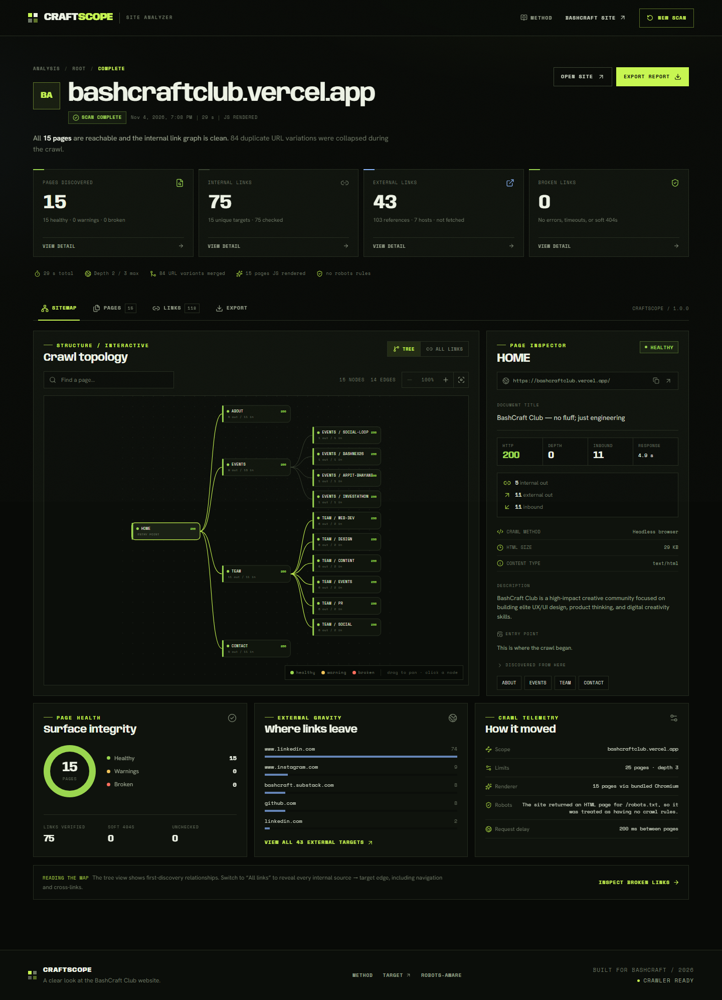
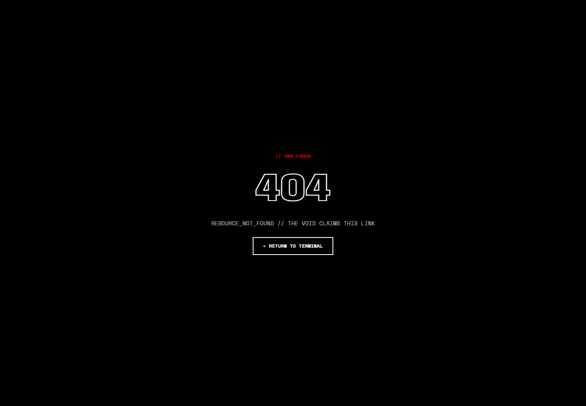

<div align="center">

# 🔭 CraftScope

**A local-first website analyzer built for [BashCraft Club](https://bashcraftclub.vercel.app/).**

Crawl a site, check every internal link, and explore the results as an interactive map, a searchable report, and portable exports.




</div>

---

## ✨ Features

- 🗺️ **Site mapping** – crawls internal pages from one starting URL, one request at a time
- 🔗 **Link checking** – flags HTTP errors, timeouts, connection failures, redirects, and soft 404s
- 🌐 **External link catalog** – recorded for context, never requested
- ⚙️ **JavaScript rendering** – headless Chromium, with automatic fallback to static HTML
- 🤖 **robots.txt aware** – wildcards, `Allow`/`Disallow` precedence, and `Crawl-delay`
- 🧹 **URL cleanup** – ignores fragments, tracking params, `www`/non-`www`, trailing slashes, and duplicate query orders
- 📡 **Live progress** – streamed over NDJSON while the scan runs
- 📦 **Exports** – JSON, three CSVs, and a sitemap XML

The UI includes an interactive sitemap graph, page inspector, sortable inventory, and a searchable link ledger. It is responsive and keyboard accessible.

---

## 🚀 Quick Start

**Requirements:** Node.js 20.19+ or 22.12+ and npm.

```bash
git clone https://github.com/avinash-chandna/bashcraft-analyzer.git
cd bashcraft-analyzer
npm install
npx playwright install chromium
```

> No API keys, `.env` file, or paid services needed. If Chromium can't launch, CraftScope tries system Chrome, then Edge, then falls back to static HTTP analysis.

**Development**

```bash
npm run dev
```

Frontend at `http://localhost:5173`, API at `http://localhost:8787`.

**Production**

```bash
npm run build
npm start
```

Open `http://localhost:8787`. Express serves both the API and the built frontend.

---

## 🧭 Using the App

1. Enter a public `http://` or `https://` URL (bare domains are upgraded to `https://`).
2. Pick a page limit and crawl depth. Optionally turn off JS rendering or robots.txt enforcement.
3. Start the scan and watch live progress.
4. Explore the report:

| Tab | What you get |
|---|---|
| **Sitemap** | Interactive hierarchy graph with pan, zoom, search, and page inspection |
| **Pages** | Filter by health, sort by depth, status, link counts, or response time |
| **Links** | Broken, internal, and external tabs with search and filters |
| **Export** | Download the report in five formats |

---

## 🧪 Demo: BashCraft Club

| | |
|---|---|
| **URL** | https://bashcraftclub.vercel.app/ |
| **Scan date** | 4 November 2026 |
| **Settings** | 25 pages, depth 3, JS rendering on, robots.txt respected |

| Pages | Internal links | Broken | External destinations | Duration |
|:-:|:-:|:-:|:-:|:-:|
| **15** | **75** | **0** | **43** (7 hosts) | **28.7 s** |

BashCraft returns HTTP 200 for unknown routes (an SPA fallback). CraftScope renders the page, detects the `404` heading and `RESOURCE_NOT_FOUND` text, and correctly classifies it as a **soft 404**.



Full evidence and output: [BASHCRAFT-DEMO.md](docs/BASHCRAFT-DEMO.md)

---

## 🔍 How It Works

| | |
|---|---|
| **Scope** | One hostname. `www`/non-`www` and `http`/`https` count as the same site; subdomains are external. |
| **Limits** | Default 25 pages / depth 3 (API allows 1–100 pages, 0–6 depth). Requests are sequential with a 200 ms minimum delay. |
| **Duplicates & loops** | Every URL is queued once; self-links and cycles are recorded, not re-crawled. |
| **Rendering** | Fresh isolated Playwright context per page. Images, media, fonts, and service workers are blocked. |
| **Redirects** | Followed only on the same site. Off-site redirects become warnings. |

**Link statuses:** `ok` · `warning` · `broken` · `blocked` (robots.txt) · `unchecked` (outside limits)

**Soft 404s** are pages that return HTTP 200 but show not-found content: a `404` or "not found" title/heading, a strong marker like `RESOURCE_NOT_FOUND`, or a very short page with a not-found phrase.

📘 URL normalization, robots.txt rules, and design decisions are covered in [TECHNICAL.md](docs/TECHNICAL.md).

---

## 📤 Exports

| Format | File | Contents |
|---|---|---|
| JSON | `*.json` | Complete structured report |
| CSV | `*-pages.csv` | Page inventory and health |
| CSV | `*-broken-links.csv` | One row per broken target/source pair |
| CSV | `*-internal-links.csv` | Every internal relationship |
| XML | `*-sitemap.xml` | Successful HTML pages only |

CSV cells are protected against formula injection and XML values are escaped. Exports are generated in the browser.

---

## 🔌 API

### `POST /api/analyze`

Streams newline-delimited JSON (NDJSON).

```bash
curl -N -X POST http://localhost:8787/api/analyze \
  -H "Content-Type: application/json" \
  -d '{"url":"https://bashcraftclub.vercel.app/","maxPages":25,"maxDepth":3}'
```

| Field | Default | Allowed |
|---|---|---|
| `url` | *required* | Public `http`/`https` URL, max 2048 chars |
| `maxPages` | `25` | 1–100 |
| `maxDepth` | `3` | 0–6 |
| `renderJs` | `true` | Boolean |
| `respectRobots` | `true` | Boolean |
| `timeoutMs` | `15000` | 3000–30000 |

<details>
<summary>Stream event types</summary>

```json
{"type":"accepted","data":{"startUrl":"...","options":{}}}
{"type":"stage","stage":"robots","message":"Checking robots.txt…"}
{"type":"progress","data":{"pagesCrawled":3,"pagesQueued":4,"currentPath":"/about"}}
{"type":"warning","message":"..."}
{"type":"complete","data":{"meta":{},"pages":[],"links":{}}}
{"type":"error","error":{"code":"INVALID_URL","message":"...","hint":"..."}}
{"type":"ping","at":1730000000000}
```

Validation errors return plain JSON before the stream starts. Scan-time errors arrive as an `error` event. Max two concurrent scans; extra requests get `429 ANALYZER_BUSY`.

</details>

### Other endpoints

- `GET /api/health` – service status, renderer availability, active scan count
- `GET /api/meta` – default URL, tool version, renderer status, and hard limits

### Configuration

| Variable | Default | Purpose |
|---|---|---|
| `PORT` | `8787` | API and production frontend port |
| `DEFAULT_ANALYZER_URL` | `https://bashcraftclub.vercel.app/` | URL reported by `/api/meta` |
| `ALLOW_PRIVATE_HOSTS` | unset | `true` allows localhost/private IP scans (trusted machines only) |

---

## 🛡️ Security

CraftScope is built for **local or trusted self-hosted use**.

- **SSRF guard** – blocks loopback, private, link-local, reserved, and cloud-metadata destinations
- **Redirect confinement** – redirects stay within the same site
- **No external requests** – external links are never fetched
- **Resource caps** – 20 KB request body, 4 MB HTML, 256 KB robots.txt, 6 redirects
- **Browser isolation** – fresh context per page, images/media/fonts/service workers disabled
- **Output safety** – text-only rendering, `rel="noreferrer noopener"`, escaped exports

> ⚠️ The SSRF check is a guardrail, not a sandbox, and rendering executes the scanned site's JavaScript. Don't expose CraftScope as a public service without authentication, rate limiting, and network isolation. `ALLOW_PRIVATE_HOSTS=true` disables the private-network guard entirely, so use it only on a machine you control.

---


<details>
<summary>Broken-link UI harness (end-to-end)</summary>

```bash
# Terminal 1: fixture site on :8899 with an external tripwire on :8898
npm run fixture

# Terminal 2: production build with private hosts allowed
npm run build
ALLOW_PRIVATE_HOSTS=true PORT=8790 npm start   # PowerShell: $env:ALLOW_PRIVATE_HOSTS="true"; $env:PORT="8790"; npm start

# Terminal 3: drive the real UI
npm run verify:ui
```

Verifies two broken targets (404 and soft 404), JS-generated pages, title warnings, "NOT REQUESTED" labeling on external links, no horizontal overflow, no console errors, and zero requests to the tripwire.

</details>

Full test matrix and known gaps: [TESTING.md](docs/TESTING.md)

---


---

## ⚠️ Known Limitations

- **Same hostname only** – subdomains are external; hash routes (`#/route`) aren't crawled
- **No status codes for external links** – by design, they are cataloged, not checked
- **Best-effort rendering** – content revealed only by scrolling, hover, or forms may be missed; no authenticated pages
- **Heuristic soft-404 detection** – unusual not-found copy can be missed or misflagged
- **Pragmatic robots.txt support** – not a full RFC implementation; `Sitemap` entries are reported but not used to seed the crawl
- **UTF-8 only** – other encodings may display garbled text
- **No persistence** – reports live in the browser session and exported files
- **Sequential crawling** – large sites are bounded by page, depth, and concurrency limits

---


## 📚 Documentation

- [Technical documentation](docs/TECHNICAL.md)
- [BashCraft demonstration](docs/BASHCRAFT-DEMO.md)
- [Testing report](docs/TESTING.md)
- [Sample report (JSON)](docs/sample-output/bashcraftclub.vercel.app-2026-11-04.json)
