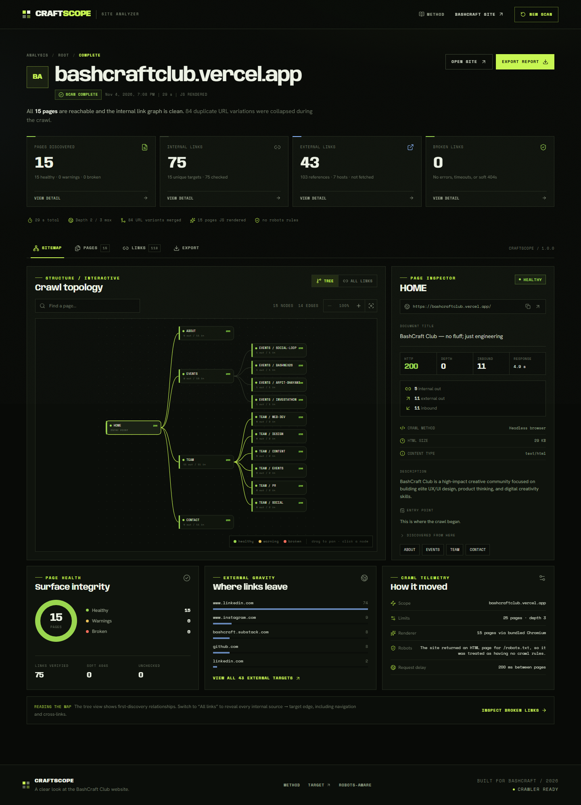
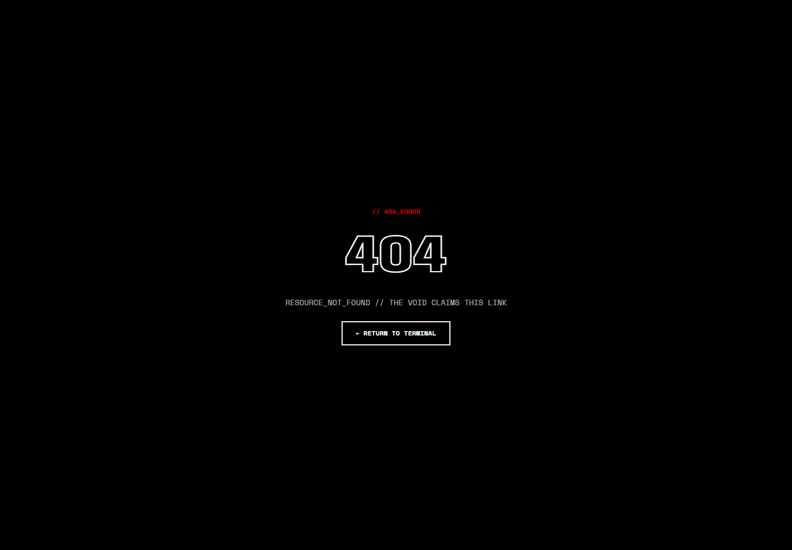

# BashCraft Demonstration

CraftScope was built for and tested against the BashCraft Club website.

**Website URL:** <https://bashcraftclub.vercel.app/>

**Scan date:** 4 November 2026  
**Settings:** 25-page limit, depth 3, JavaScript rendering on, robots.txt respected, 15 s timeout  
**Renderer:** bundled Playwright Chromium  
**Result:** successful scan, 15 pages, 75 internal links checked, 0 broken, 43 external destinations catalogued



## Why BashCraft is a useful test target

BashCraft is a React single-page application, which makes it a realistic stress test rather than a static HTML sample:

- Routes are generated client-side, so link discovery requires JavaScript rendering.
- Unknown routes return **HTTP 200** with a custom “not found” screen instead of an HTTP 404.
- `/robots.txt` returns the SPA shell as **HTML** rather than a robots.txt document.
- Social and event links point to many external destinations, which must be catalogued without being fetched.
- Primary navigation repeats many links, producing a large number of URL variants and duplicate occurrences.

## Exact scan output

The completed report is preserved at [sample-output/bashcraftclub.vercel.app-2026-11-04.json](sample-output/bashcraftclub.vercel.app-2026-11-04.json).

| Metric | Value |
| --- | ---: |
| Pages discovered | 15 |
| Healthy pages | 15 |
| Warning pages | 0 |
| Broken pages | 0 |
| Internal link relationships | 75 |
| Unique internal targets | 15 |
| Internal links checked | 75 |
| Broken internal links | 0 |
| External destinations | 43 |
| External link occurrences | 103 |
| External hosts | 7 |
| Duplicate URL occurrences merged | 84 |
| Maximum depth reached | 2 (of 3 allowed) |
| Page limit reached | No |
| Scan duration | 28.7 s |
| Pages rendered with JavaScript | 15 |
| Pages using HTTP fallback | 0 |
| Scan-level warnings | 0 |

### Discovered page tree

```text
/
├── /about
├── /contact
├── /events
│   ├── /events/arpit-bhayani
│   ├── /events/bashnex26
│   ├── /events/investathon
│   └── /events/social-loop
└── /team
    ├── /team/content
    ├── /team/design
    ├── /team/events
    ├── /team/pr
    ├── /team/social
    └── /team/web-dev
```

All 15 pages returned HTTP 200, rendered successfully, and had no warnings. The repeated page title (`BashCraft Club — no fluff; just engineering`) is the site's own SPA title, not a scraper failure.

### External destinations

External links were recorded but never requested. The seven host groups were:

| Host | Targets | References |
| --- | ---: | ---: |
| `www.linkedin.com` | 36 | 74 |
| `www.instagram.com` | 2 | 9 |
| `bashcraft.substack.com` | 1 | 8 |
| `github.com` | 1 | 8 |
| `linkedin.com` | 1 | 2 |
| `docs.google.com` | 1 | 1 |
| `forms.gle` | 1 | 1 |

## Live soft-404 evidence

BashCraft returns **HTTP 200** for an unknown client-side route. CraftScope renders the page before deciding whether it is a soft 404, because the static HTML shell does not contain the fallback text.

**Probe URL:** <https://bashcraftclub.vercel.app/__craftscope_missing_route__>

Observed after rendering:

```json
{
  "title": "BashCraft Club — no fluff; just engineering",
  "h1": "404",
  "hasMarker": true,
  "hasVoidPhrase": true,
  "bodyExcerpt": "// 404_ERROR 404 RESOURCE_NOT_FOUND // THE VOID CLAIMS THIS LINK ← RETURN TO TERMINAL"
}
```

- HTTP status: `200`
- Content type: `text/html; charset=utf-8`
- Rendered heading: `404`
- Rendered marker: `RESOURCE_NOT_FOUND // THE VOID CLAIMS THIS LINK`
- CraftScope result: **soft 404 → broken**
- Evidence screenshot: [bashcraft-soft404.png](../screenshots/bashcraft-soft404.png)



This is exactly the case that a plain HTTP status check would miss. It is covered by the unit test `soft 404 detection catches the BashCraft SPA fallback` and by the local integration fixture.

## Live robots.txt evidence

**Probe URL:** <https://bashcraftclub.vercel.app/robots.txt>

| Check | Observed |
| --- | --- |
| HTTP status | 200 |
| Content type | `text/html; charset=utf-8` |
| First bytes | `<!DOCTYPE html>` |
| CraftScope interpretation | HTML app shell, not robots.txt |
| Rules applied | 0 |
| Report note | “The site returned an HTML page for `/robots.txt`, so it was treated as having no crawl rules.” |

The analyzer does not treat returned HTML as robots directives. This avoids accidentally parsing app markup as crawl rules.

## Export evidence

The same completed report was exported and validated in all five formats:

| Format | Result |
| --- | --- |
| [JSON](sample-output/bashcraftclub.vercel.app-2026-11-04.json) | Parsed successfully; 15 page records and full link graph |
| [Pages CSV](sample-output/bashcraftclub.vercel.app-2026-11-04-pages.csv) | 16 lines: header + 15 pages |
| [Broken-links CSV](sample-output/bashcraftclub.vercel.app-2026-11-04-broken-links.csv) | Header only, because there were no broken links |
| [Internal-links CSV](sample-output/bashcraftclub.vercel.app-2026-11-04-internal-links.csv) | 76 lines: header + 75 relationships |
| [Sitemap XML](sample-output/bashcraftclub.vercel.app-2026-11-04-sitemap.xml) | Valid XML urlset with 15 `<loc>` entries |

The files were generated through the real Export tab in headless Chromium, not hand-written. To reproduce them, run the built app and execute `node scripts/export-sample.mjs` (see the script header for arguments). The Export tab is shown in [export-desktop.png](../screenshots/export-desktop.png). Exports are generated client-side from the displayed report.

## Screenshots

| View | Desktop | Mobile |
| --- | --- | --- |
| Landing | [landing-desktop.png](../screenshots/landing-desktop.png) | [landing-mobile.png](../screenshots/landing-mobile.png) |
| Report / sitemap | [report-desktop.png](../screenshots/report-desktop.png) | [report-mobile.png](../screenshots/report-mobile.png) |
| Pages | [pages-desktop.png](../screenshots/pages-desktop.png) | — |
| Links | [links-desktop.png](../screenshots/links-desktop.png) | [links-mobile.png](../screenshots/links-mobile.png) |
| Export | [export-desktop.png](../screenshots/export-desktop.png) | — |
| Method modal | [method-modal.png](../screenshots/method-modal.png) | — |
| BashCraft soft-404 fallback | [bashcraft-soft404.png](../screenshots/bashcraft-soft404.png) | — |

## How to reproduce the scan

```bash
npm install
npx playwright install chromium
npm run build
npm start
```

1. Open <http://localhost:8787>.
2. Leave the default URL as `https://bashcraftclub.vercel.app/`, or enter it manually.
3. Keep the page limit at 25 and depth at 3.
4. Leave **Render JavaScript** and **Respect robots.txt** enabled.
5. Start the scan and wait for the report.

For development with hot reload:

```bash
npm run dev
# open http://localhost:5173
```

Scan results can change if BashCraft updates its routes or content. The preserved JSON and screenshots document the run described above.
